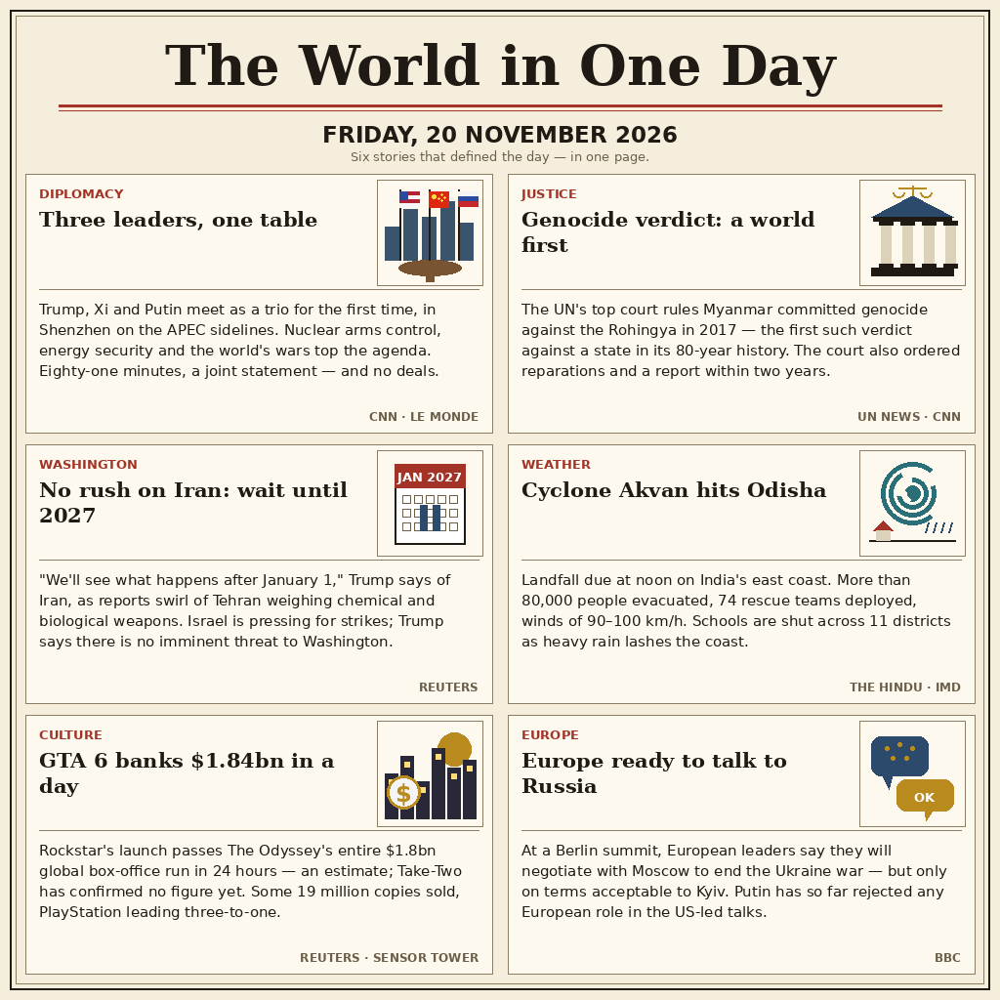

# The World in One Day — 20 November 2026

[](https://make.fun/bounty/news-image-20261120)
[](https://make.fun/bounty/news-image-20261120/leaderboard)
[](https://make.fun/bounty/news-image-20261120)

A one-page newspaper front page that sums up Friday, 20 November 2026
in a single 1024×1024 image. Masthead: **"The World in One Day"**,
with the date line prominent at the top and six panels — one per story —
each with a small hand-drawn vector illustration, a headline, a short
summary and a source line. Warm newsprint background, restrained colours,
clean typography; everything is legible at full size with no overlapping
or clipped text.



## The six stories

1. **Three leaders, one table** — Trump, Xi and Putin meet as a trio for
   the first time, in Shenzhen on the APEC sidelines. Nuclear arms control,
   energy security and the world's wars top the agenda. Eighty-one minutes,
   a joint statement — and no deals. *(CNN · Le Monde)*
2. **Genocide verdict: a world first** — The UN's top court rules Myanmar
   committed genocide against the Rohingya in 2017 — the first such verdict
   against a state in the court's 80-year history. Reparations ordered, a
   report due within two years. *(UN News · CNN)*
3. **No rush on Iran: wait until 2027** — "We'll see what happens after
   January 1," Trump says of Iran, as reports swirl of Tehran weighing
   chemical and biological weapons. *(Reuters)*
4. **Cyclone Akvan hits Odisha** — Landfall due at noon on India's east
   coast. More than 80,000 people evacuated, 74 rescue teams deployed,
   winds of 90–100 km/h. *(The Hindu · IMD)*
5. **GTA 6 banks $1.84bn in a day** — Rockstar's launch passes The
   Odyssey's entire $1.8bn global box-office run in 24 hours — an estimate;
   Take-Two has confirmed no figure yet. *(Reuters · Sensor Tower)*
6. **Europe ready to talk to Russia** — At a Berlin summit, European leaders
   say they will negotiate with Moscow to end the Ukraine war — but only on
   terms acceptable to Kyiv. *(BBC)*

## How it is made

`draw.py` draws the whole page from scratch with Pillow — flat vector-style
shapes (flags and a skyline, court columns, a calendar, a storm spiral, a
city skyline, speech bubbles), DejaVu Serif/Sans from the system fonts.
No photos, no AI-generated art, no downloaded assets of any kind. The
output is deterministic: running the script twice produces byte-identical
PNGs.

`main.ts` is a Node 22 program using only the standard library. It copies
the committed `entry.png` into the directory named by `MAKEFUN_OUTPUT_DIR`
(default `/output`), creating the directory if needed — so both grader
runs write identical bytes.

## Run it

```bash
# Regenerate the image (deterministic)
python3 draw.py

# Run the entrypoint
mkdir -p out && MAKEFUN_OUTPUT_DIR=out node main.ts
# -> out/entry.png (1024x1024, under 1 MiB)
```

---

Built for the [news-image-20261120](https://make.fun/bounty/news-image-20261120)
bounty on [make.fun](https://make.fun/r/vpy7svgm).
